<!-- ♡ deiv's profile · pinkpantheress edition ♡ -->

  <i>"find your dreams, then make them come true"</i>
   
  ⋆ ˚｡⋆ ୨୧ ⋆ ˚｡⋆

  
    
  

**`software engineer — full stack / llms / ai agents`**

hi, i'm deiv ♡ a software engineer from salvador, brazil. i work full stack, from pixels on the screen down to the database, and lately most of my time goes into building with llms, rag and ai agents.

things i'm into right now:

- **full stack, end to end.** react & next.js on the front, node.js, python, java and spring boot on the back.
- **llms that actually help.** retrieval-augmented generation, tool-using agents and the glue that makes them reliable.
- **shipping to the cloud.** docker containers and aws, so things leave my laptop and reach people.
- **learning while building.** i'm an information systems student @ ufba.

portuguese is my native language and my english is c1, so feel free to say hi in either ♡

<table align="center">
<tr>
  <td align="center" width="33%">
    <b>♡ location</b> 
    salvador, brazil (utc−03:00)
  </td>
  <td align="center" width="33%">
    <b>♡ studying</b> 
    information systems @ ufba
  </td>
  <td align="center" width="33%">
    <b>♡ building</b> 
    full stack · rag · ai agents
  </td>
</tr>
</table>

 

## ୨୧ code stack ୨୧

  
  
  
  
  
  
  
  
  
  
  
  
  
  
  

 

  <samp>♡ ⊹ ࣪ ˖ ୨୧ ⋆ ˚｡⋆ ୨୧ ˚ ⋆ ࣪ ⊹ ♡</samp>
    
  more at <a href="https://www.deiv.com.br">deiv.com.br</a> · <a href="https://www.linkedin.com/in/deivcst">linkedin</a> · <a href="https://open.spotify.com/user/22jgejypboproxztztbovwzoq">spotify</a>
   
  <i>kiss the build, ship the dream ♡</i>

